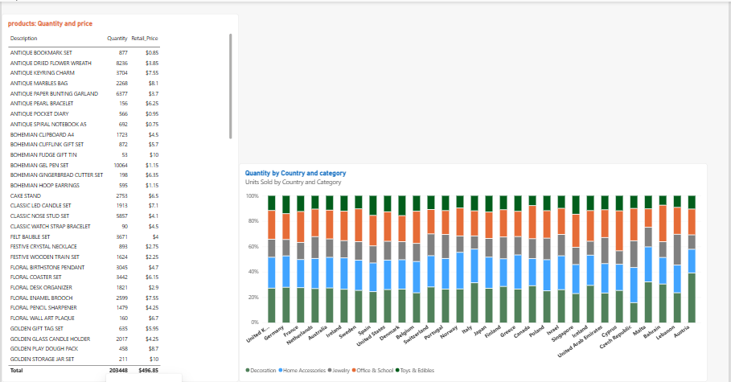
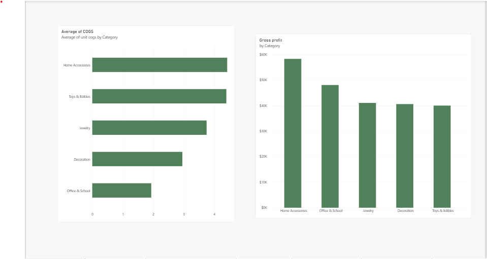
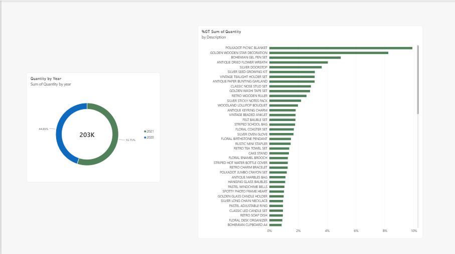
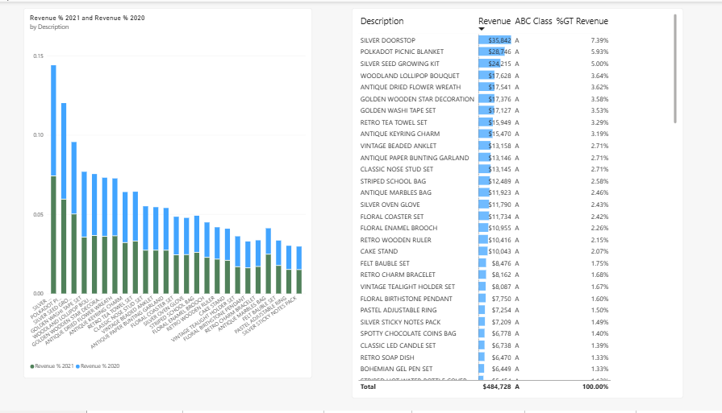
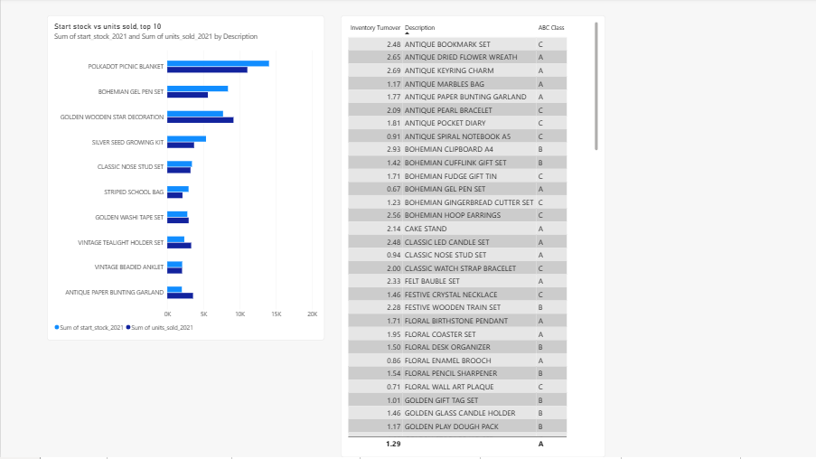
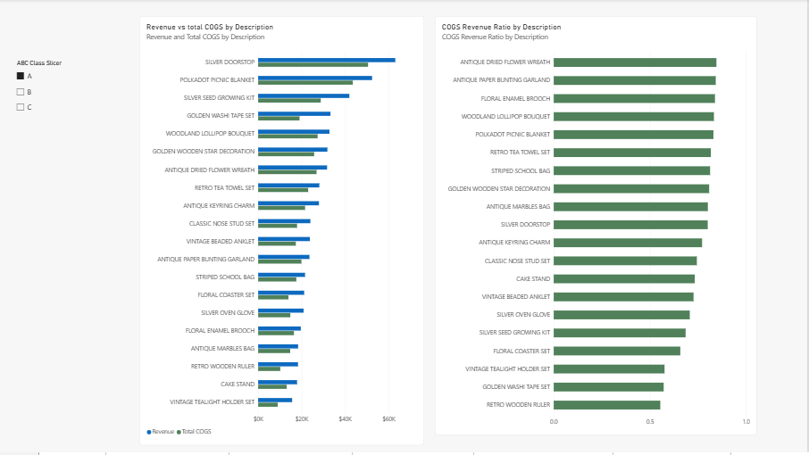
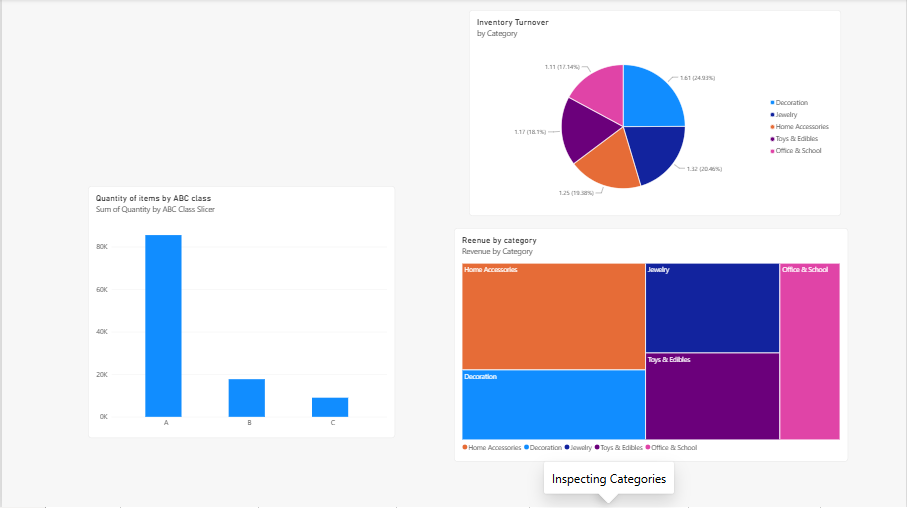
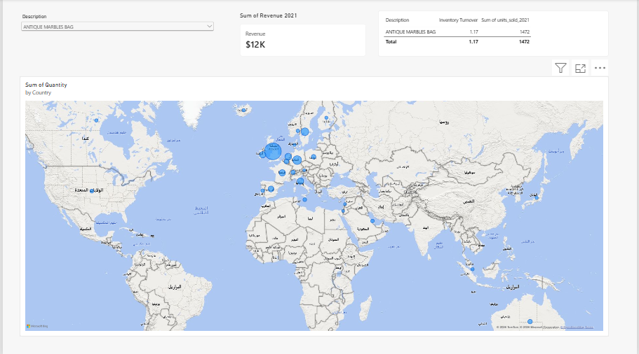
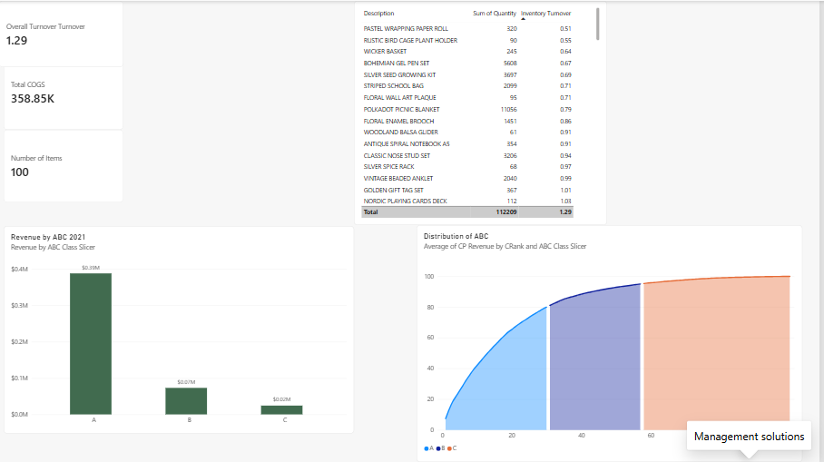

# Inventory ABC Analysis: EverGlow Gifts

A Business Reporting case study built with Power BI.
**Note:** The data is simulated for portfolio purposes.

## Business Question
Which products deserve higher priority in inventory replenishment?

## Tools
Power BI, DAX, Excel

## Project Steps
1. Data cleaning and preparation
2. Data model
3. Revenue, COGS and Gross Profit
4. Inventory Turnover
5. ABC Classification
6. 9-page report

## Key Insights
- The best-selling product is not necessarily the fastest-moving one
- Class A products generate most of the revenue
- Revenue alone should not drive replenishment decisions

## Recommendations
1. Prioritize Class A items with safety stock and weekly review.
2. Increase order quantities for items whose 2021 sales exceeded opening stock (e.g., Golden Wooden Star Decoration) to avoid stockouts.
3. Reduce purchasing or run promotions for overstocked items (e.g., Polkadot Picnic Blanket).
4. Monitor high-turnover Class C items (e.g., Antique Bookmark Set) before reducing their stock.
5. Do not rely on revenue alone for replenishment decisions; use turnover, COGS and ABC class together.
   
## Report Pages

### 1. Preparing data

### 2. COGS, Revenue and Profit

### 3. Sales by year

### 4. Revenue and class

### 5. Preliminary results

### 6. Smart purchasing

### 7. Inspecting categories

### 8. Control decisions

### 9. Management solutions

